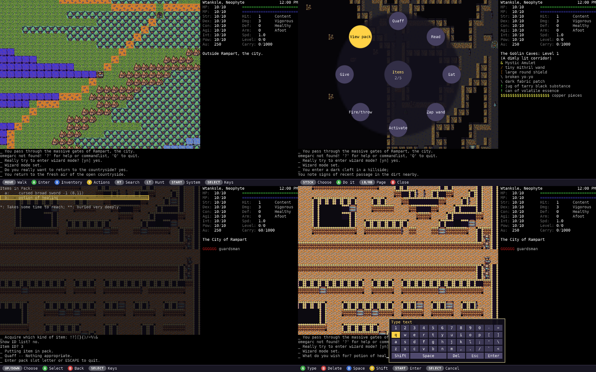
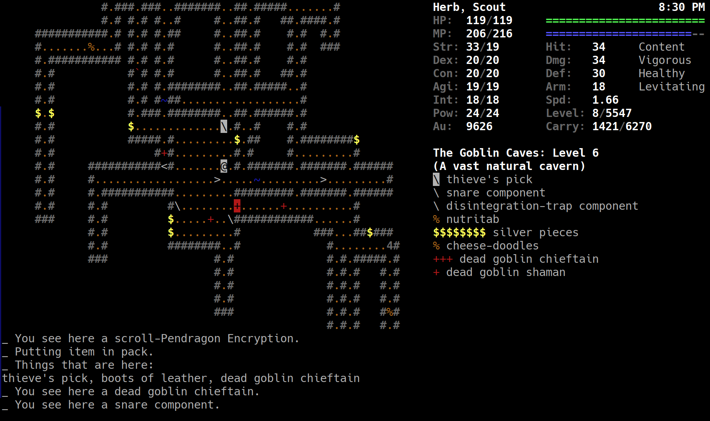

# OmegaDeck

**Omega, the 1987 roguelike, rebuilt for Steam Deck and other handhelds.** It has 2D pixel-art
tiles and console-style controls, so you can play the whole game on a gamepad or touchscreen.



This is a fork of [Lyle Tafoya's C++ Omega](https://github.com/Lyle-Tafoya/Omega). Nearly all
of the game here is the work of Laurence R. Brothers, the Omega contributors and Lyle Tafoya.
OmegaDeck adds the handheld frontend on top of it. Full credits are in
[docs/CREDITS.md](docs/CREDITS.md).

## What OmegaDeck adds

- **2D tiles.** DawnLike art (by DragonDePlatino, with the DawnBringer palette) covers every
  monster, item and terrain type in the dungeons, towns and the overworld. Walls join up, and
  unidentified potions and scrolls never give their identity away through their sprite.
- **Gamepad controls.** The stick moves you, and **A** does whatever makes sense where you're
  standing. **Y** opens an action wheel with every command, and menus and prompts turn into
  lists you can pick from. A hint bar always shows what each button does right now.
- **On-screen keyboard.** It pops up by itself for wishes, names and numbers, and you can
  bring it up any time with Select.
- **Touchscreen.** Tap the map to walk, and tap list entries and keyboard keys.
- **Deck-ready releases.** GitHub Actions builds a tarball on every push to `main`. Unpack it,
  add `omega.sh` to Steam, and pick the Gamepad controller template.

See [docs/README-HANDHELD.md](docs/README-HANDHELD.md) for the controls, install steps and options.

Building is the same as below. The SDL2 frontend is on by default and needs the SDL2
development headers (`libsdl2-dev` on Debian/Ubuntu). Pass `-DOMEGA_SDL=OFF` to get the
original curses version.

---

*The rest of this README is from the upstream project.*

# Omega

My C++ fork of the 1987 roguelike "Omega", featuring numerous bug-fixes as well as balance and UI improvements.


## Build Instructions

### Linux

On distros with GCC versions >= 13, you can perform the following steps:

```
git clone https://github.com/Lyle-Tafoya/Omega.git
mkdir Omega/build
cd Omega/build
cmake ..
cmake --build .
```

#### Ubuntu

```
sudo add-apt-repository ppa:ubuntu-toolchain-r/test
sudo apt update
sudo apt install g++-13
git clone https://github.com/Lyle-Tafoya/Omega.git
mkdir Omega/build
cd Omega/build
CXX=g++-13 cmake ..
cmake --build .
```

### MacOS

Tested on macOS 15.7.1

```
brew install cmake
git clone https://github.com/Lyle-Tafoya/Omega.git
mkdir Omega/build
cd Omega/build
cmake ..
cmake --build .
```


### Windows

I have been building Omega for Windows using NMake from the "x64 Native Tools Command Prompt for VS 2022"

```
git clone https://github.com/Lyle-Tafoya/Omega.git
mkdir Omega\build
cd Omega\build
cmake .. -G "NMake Makefiles" -DCMAKE_BUILD_TYPE=Release
cmake --build .
```

By default, Omega will run in an OpenGL window. To run in the Windows terminal instead, you can build with the following commands:

```
git clone https://github.com/Lyle-Tafoya/Omega.git
mkdir Omega\build
cd Omega\build
cmake .. -G "NMake Makefiles" -DCMAKE_BUILD_TYPE=Release -DPDC_GL_BUILD=OFF
cmake --build .
```

## Credits

Omega was created by **Laurence R. Brothers** (1987–1989), and was later maintained and extended
by **Erik Max Francis**, **Nathan Glasser**, **Robert Rendell**, **William Tanksley** and many
others. The C++ port is by **Lyle Tafoya**. The OmegaDeck handheld frontend uses **DawnLike** art
by **DragonDePlatino** and **DawnBringer** (CC-BY 4.0), via **Tommy Ettinger**'s DawnLikeAtlas.
The full list, with licences, is in [docs/CREDITS.md](docs/CREDITS.md).
